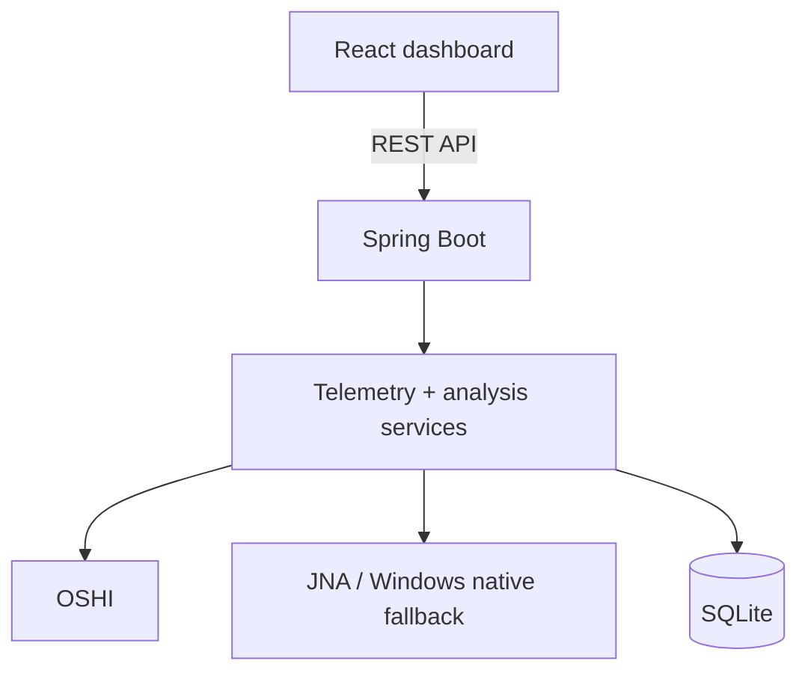

# Smart Battery Investigator

A Windows-focused desktop telemetry application that detects unusually high battery drain and ranks
the running processes most strongly **associated** with those intervals.

The project combines real system telemetry, rolling statistical analysis, local SQLite persistence,
and a React dashboard. It is designed as a technically defensible Computer Engineering / Software
Engineering portfolio project rather than a claim of direct per-process power measurement.

## Features

- Samples battery state and running-process telemetry on a configurable background interval.
- Uses OSHI for battery, CPU, memory, process path, start time, and cumulative CPU information.
- Uses JNA with Windows `GetSystemPowerStatus` as a fallback for battery percentage and AC state.
- Persists timestamped measurements in a local SQLite database.
- Filters insignificant processes with configurable CPU and memory thresholds.
- Calculates battery drain across rolling windows rather than isolated percentage changes.
- Detects high-drain periods using an absolute threshold plus a historical statistical baseline.
- Ranks **Associated Processes** using CPU load, CPU increase over baseline, memory, and presence.
- Exposes a read-only REST API between Spring Boot and React.
- Includes a deterministic mock/demo telemetry provider for non-Windows machines and presentations.
- Includes unit, repository, aggregation, and controller tests for the important analytical paths.

## Screenshots

Screenshot placeholders are intentionally not fabricated. After running the application, add real
captures to:

```text
docs/images/dashboard.png
docs/images/event-details.png
```

Then embed them here, for example:

```markdown

```

## Architecture



See [docs/architecture.md](docs/architecture.md) for the detailed data flow.

## How It Works

1. **Telemetry collection** — a Spring scheduled service samples the selected `TelemetryProvider`.
2. **Persistence** — one battery sample and its filtered process samples are written to SQLite.
3. **Drain detection** — the newest battery window is normalized to percent-per-hour and compared
   with the configured absolute and historical thresholds.
4. **Process attribution** — process metrics during a high-drain interval are compared with a
   pre-event baseline and converted to a 0–100 association score.
5. **Visualization** — React polls the REST API and displays battery history, high-drain intervals,
   event details, process rankings, and the current process snapshot.

## Tech Stack

### Backend

- Java 17+
- Spring Boot 4.1.1
- Maven
- OSHI 7.6.1
- JNA 5.19.1 (used transitively by OSHI and directly for `GetSystemPowerStatus`)
- SQLite JDBC 3.53.4.0
- Spring JDBC
- JUnit 5 / Mockito

### Frontend

- React 19.3.0
- JavaScript
- Vite 8.3.0
- Recharts 3.10.1

## Requirements

For a normal Windows run:

- Windows 10 or Windows 11
- JDK 17 or newer
- Maven 3.9+
- Node.js 20.19+ (Node 22 LTS also works)
- npm

The backend can run on non-Windows systems, but real Windows-native battery telemetry is naturally
unavailable there. Use demo mode for a complete cross-platform demonstration.

## Installation

### 1. Clone the repository

```powershell
git clone https://github.com/YOUR-USERNAME/smart-battery-investigator.git
cd smart-battery-investigator
```

Replace `YOUR-USERNAME` after you create the GitHub repository.

### 2. Verify required tools

```powershell
java -version
mvn -version
node --version
npm --version
```

## Running the Backend

From the repository root:

```powershell
cd backend
mvn spring-boot:run
```

The backend starts on:

```text
http://localhost:8080
```

The default telemetry mode is `windows`.

The local database file is created as:

```text
backend/smart-battery.db
```

It is ignored by Git.

## Running the Frontend

Open a second terminal:

```powershell
cd smart-battery-investigator\frontend
npm install
npm run dev
```

Open:

```text
http://localhost:5173
```

Vite proxies `/api` requests to the Spring Boot backend at port 8080.

## Demo Mode

Demo mode never pretends to be real hardware telemetry. It is an explicit, deterministic synthetic
provider intended for reviewers, presentations, CI-like environments, and machines without usable
battery sensors.

The easiest demonstration uses the included `demo` Spring profile:

```powershell
cd backend
mvn spring-boot:run -Dspring-boot.run.profiles=demo
```

That profile selects:

```yaml
app.telemetry.mode: mock
```

and shortens the sampling/analysis windows so high-drain events appear sooner.

You can also select only the mock provider while keeping the normal analysis defaults:

```powershell
mvn spring-boot:run -Dspring-boot.run.arguments="--app.telemetry.mode=mock"
```

The mock workload includes recognizable synthetic processes such as:

- `chrome.exe`
- `Code.exe`
- `Discord.exe`
- `java.exe`
- `Teams.exe`

## Configuration

Main defaults live in `backend/src/main/resources/application.yml`.

| Property | Default | Purpose |
|---|---:|---|
| `app.telemetry.mode` | `windows` | Selects `windows` or `mock` telemetry |
| `app.telemetry.sampling-interval-ms` | `5000` | Delay between completed samples |
| `app.telemetry.initial-delay-ms` | `1000` | Delay before the first sample |
| `app.process-filter.minimum-cpu-percent` | `0.5` | CPU threshold for retaining a process |
| `app.process-filter.minimum-memory-mb` | `75` | Memory threshold for retaining a process |
| `app.process-filter.maximum-processes-per-sample` | `80` | Maximum retained processes per sample |
| `app.analysis.rolling-window-minutes` | `5` | Battery drain calculation window |
| `app.analysis.historical-baseline-hours` | `24` | Historical drain baseline horizon |
| `app.analysis.minimum-high-drain-percent-per-hour` | `10.0` | Absolute high-drain floor |
| `app.analysis.standard-deviation-multiplier` | `1.5` | Statistical baseline multiplier |
| `app.analysis.minimum-baseline-windows` | `3` | Windows required before statistical filtering |
| `app.analysis.interval-merge-gap-seconds` | `30` | Gap allowed when extending one event |
| `app.analysis.process-baseline-minutes` | `30` | Pre-event process CPU baseline |
| `app.analysis.maximum-associated-processes` | `10` | Stored scores per drain event |
| `app.demo.random-seed` | `42` | Deterministic mock telemetry seed |

Spring configuration can also be overridden using command-line arguments or environment variables.

## API

| Method | Endpoint | Description |
|---|---|---|
| GET | `/api/status` | Collector, database, current battery, rolling drain status |
| GET | `/api/battery/current` | Latest battery sample |
| GET | `/api/battery/history?hours=24` | Battery history |
| GET | `/api/processes/current` | Latest significant process snapshot |
| GET | `/api/drain-intervals?hours=24` | Detected high-drain periods |
| GET | `/api/drain-intervals/{id}` | Event timeline and associated processes |
| GET | `/api/processes/ranking?hours=24` | Repeated high-drain process associations |
| GET | `/api/analytics/summary?hours=24` | Summary drain statistics and process ranking |

`hours` is limited to 1–168 to keep local queries bounded.

## Analysis Algorithm

### Battery drain

For a valid discharging window:

```text
drainRate = (startingBatteryPercent - endingBatteryPercent)
            / durationHours
```

Windows are excluded if charging occurs, discharge state is unknown, telemetry is insufficient, or
the reported percentage rises.

### High-drain detection

With enough baseline history:

```text
highDrain =
    currentDrainRate >= minimumDrainThreshold
    AND
    currentDrainRate >
        historicalAverage + multiplier * historicalStandardDeviation
```

With insufficient history, the absolute threshold is used as a cold-start rule.

### Associated-process ranking

The score is normalized to 0–100:

```text
score =
    0.50 * normalizedAverageCpu
  + 0.25 * normalizedCpuIncreaseAboveBaseline
  + 0.10 * normalizedMemory
  + 0.15 * presenceRatio
```

See [docs/algorithm.md](docs/algorithm.md) for normalization details and assumptions.

## Error Handling

- Missing battery/native metrics are stored as `null`; the collector keeps running.
- A failed collection is logged and retried on the next scheduled interval.
- SQLite failures are surfaced as HTTP `503 Service Unavailable` where appropriate.
- Invalid API parameters return `400 Bad Request`.
- Missing drain intervals / current telemetry return `404 Not Found`.
- The dashboard displays backend errors without crashing the React application.

## Logging

Important lifecycle and operational events are logged with SLF4J / Spring logging:

- application startup;
- telemetry provider initialization;
- mock-mode activation;
- telemetry collection failures;
- detected high-drain intervals;
- unavailable Windows-native metrics.

Routine successful five-second samples are intentionally not logged.

## Tests

Run the backend test suite:

```powershell
cd backend
mvn test
```

The suite includes meaningful tests for:

- drain-rate calculation;
- charging-window rejection;
- high-drain threshold logic;
- process scoring;
- telemetry summary aggregation;
- SQLite repository behavior;
- REST controller error behavior.

Build the frontend:

```powershell
cd frontend
npm install
npm run build
```

## Limitations

- **Association is not causation.** Standard process CPU and memory telemetry cannot prove the
  electrical power attributable to one process.
- Windows laptops expose battery information inconsistently. Voltage, instantaneous power rate,
  capacity units, and even battery presence can vary by firmware and driver.
- Battery percentage often changes in discrete steps, so short rolling windows can still be noisy.
- CPU-heavy work is strongly represented in the score, while GPU, display brightness, radios, and
  device-specific energy use are not attributed to individual processes.
- The application is local-first and does not currently implement a packaged Windows installer or
  system-tray lifecycle.

## Future Improvements

- Windows ETW / Energy Estimation Engine integration where practical.
- Longer-term per-process baselines and time-of-day comparisons.
- GPU and disk I/O signals in the association score.
- System-tray operation and high-drain notifications.
- Exportable CSV / JSON diagnostic reports.
- Optional data retention and pruning policies.
- Packaged desktop distribution with the React build embedded in Spring Boot.

## Repository Structure

```text
smart-battery-investigator/
├── README.md
├── LICENSE
├── .gitignore
├── .gitattributes
├── backend/
│   ├── pom.xml
│   └── src/
│       ├── main/
│       │   ├── java/com/alexbalutin/smartbattery/
│       │   │   ├── analysis/
│       │   │   ├── api/
│       │   │   ├── config/
│       │   │   ├── model/
│       │   │   ├── repository/
│       │   │   ├── service/
│       │   │   └── telemetry/
│       │   └── resources/
│       │       ├── application.yml
│       │       ├── application-demo.yml
│       │       └── schema.sql
│       └── test/java/com/alexbalutin/smartbattery/
├── frontend/
│   ├── package.json
│   ├── vite.config.js
│   ├── index.html
│   └── src/
│       ├── components/
│       ├── services/
│       ├── App.jsx
│       ├── main.jsx
│       └── styles.css
└── docs/
    ├── architecture.md
    ├── algorithm.md
    └── images/
```

## Run Instructions

From a fresh clone, first start the backend:

```powershell
cd smart-battery-investigator\backend
mvn test
mvn spring-boot:run
```

In another terminal:

```powershell
cd smart-battery-investigator\frontend
npm install
npm run build
npm run dev
```

For a hardware-independent demonstration:

```powershell
cd smart-battery-investigator\backend
mvn spring-boot:run -Dspring-boot.run.profiles=demo
```

Then browse to `http://localhost:5173`.

## Repository Verification

These commands are expected to succeed on a machine with the documented prerequisites:

```bash
cd backend
mvn test
mvn package
mvn spring-boot:run
```

and:

```bash
cd frontend
npm install
npm run build
npm run dev
```

The backend should create its SQLite database automatically, begin scheduled telemetry collection,
and expose `/api/status`. The frontend should build with Vite and load the dashboard through the
proxied REST API.
