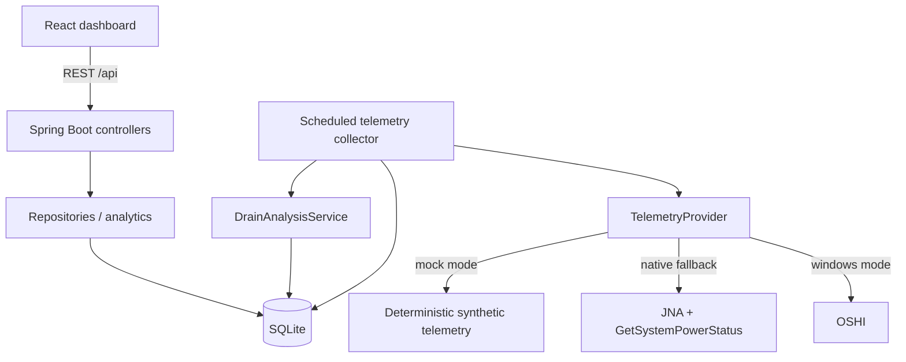

# Architecture

Smart Battery Investigator is split into a local Spring Boot backend and a React frontend.

## Backend responsibilities

- `TelemetryProvider` hides the source of system data.
- `WindowsTelemetryProvider` reads process and battery information through OSHI and uses
  `GetSystemPowerStatus` through JNA as a fallback for Windows battery percentage / power state.
- `MockTelemetryProvider` generates deterministic demo telemetry only when mock mode is selected.
- `TelemetryCollectorService` runs independently of HTTP request threads using Spring scheduling.
- Repositories use `JdbcTemplate` and explicit SQL against SQLite.
- Analysis classes are small, testable components for drain-rate calculation, high-drain detection,
  process scoring, and summary aggregation.
- REST controllers expose DTOs rather than database records directly.

## Data flow

1. The scheduled collector asks the selected telemetry provider for one snapshot.
2. A battery row and filtered process rows are persisted in one database transaction.
3. The analysis service evaluates the newest rolling battery window.
4. A high-drain decision may create or extend a persisted drain interval.
5. Process telemetry for that interval is compared with a pre-event baseline and scored.
6. The React dashboard refreshes read-only API endpoints and visualizes the results.

## Concurrency

Spring's scheduler executes telemetry collection outside request handling. The default collector uses
a fixed delay, so a slow collection cannot overlap the next collection. SQLite uses a small,
single-connection Hikari pool because the workload is local, write-light, and intentionally simple.
